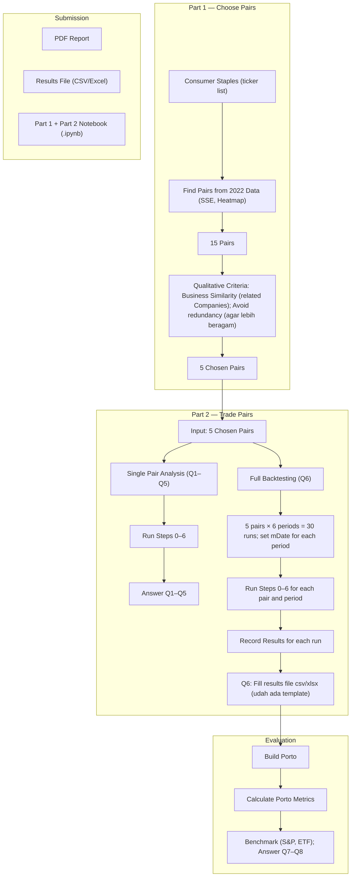

Chung-Ang University
CAU Business School
Fintech and Quant Trading

## 핀테크와 퀀트 트레이딩

## Hong Kee Sul

# Midterm Project: Pairs Trading

## Due Tuesday 20 October 2026, 23:59

This project is loosely based on Gatev, Goetzmann and Rouwenhorst (2006), Pairs Trading: Performance
of a Relative-Value Arbitrage Rule. You will find pairs of stocks in one sector that have moved together,
trade them with a simple rule, and judge whether the rule makes money.

This is a team project, done in your eClass group. If you have not joined a group yet, do that first. There
are two parts, done in order: Part 1 picks the pairs and Part 2 trades them. Your team hands in one zip
file covering both.

## Claiming a sector

Each team works on a different sector, claimed first come, first served on the post "Midterm - sector
claim (FCFS)" in 게시판 → General Discussion. Read the existing comments first and pick a sector no
other team has taken. One member comments for the team, in this form: Group 3 / Health Care

Use the sector name exactly as written here, because the notebook matches it letter for letter:
Communication Services, Consumer Discretionary, Consumer Staples, Energy, Financials, Health Care,
Industrials, Information Technology, Materials, Real Estate, Utilities.

## Part 1. Choosing your pairs

Notebook: https://colab.research.google.com/drive/1HOpGLRLGcsL0Nr42AN9_piyI0UFViGbn?usp=sharing

- Run the notebook once as it is (Runtime, then Run all) and work through what each step produces. If
  the calcSse and find_pairs functions in Step 5 are too difficult, you can treat them as a black box.
- In Step 2, set mySector to your sector and sDate to "2022-01-01". The notebook then uses one year
  of prices, 2022-01-01 to 2022-12-31.
- At the top of Step 5, set MAX_SSE to 1000 and run Steps 5 to 7. That is higher than any pair's SSE, so
  Step 7 lists every pair in your sector, from the lowest SSE to the highest.
- Your candidates are the first 15 pairs in that list, the 15 that tracked each other most closely in 2022.
  Then set MAX_SSE just above the SSE of the 15th pair and run Steps 5 and 6 again, so that the heatmap
  shows only your candidates.
- From those 15, choose 5 pairs. The SSE ranking is only a starting point. Use your own judgement
  about which firms are really in related businesses, as the example in Step 8 does.

Why 2022: in Part 2 you trade these pairs from 2023 to 2025. Choosing them on 2022 prices means
nothing you used to pick them comes from the period you then test them on. Picking pairs with hindsight
would make almost any strategy look good.

## Part 2. Trading your pairs

Notebook: https://colab.research.google.com/drive/1JswxB90Ah3T5HxQZ_mY5_LIjuAFw4azx?usp=sharing

Fintech and Quant Trading · 2026 Fall · Hong Kee Sul (hksul@cau.ac.kr)1

In Step 0-2 you set two tickers and mDate, the first day of trading. The notebook works out the rest: a
12-month formation period before mDate, used to measure how far the pair normally drifts apart, and a
6-month trading period after it.

First, one pair over one period. Take one of your five pairs, set ticker1 and ticker2 in Step 0-2, set mDate
to "2023-01-01", and run Steps 0 to 6. The formation period is then 2022, the same year you chose the
pair on, and the trading period is the first half of 2023. Then answer Q1 to Q5.

Q1. Which pair did you choose (ticker1 and ticker2)?

Q2. In Step 1-2, do the two cumulative returns look alike in the formation period? In Step 2-2, do they
look alike in the trading period, and do they drift apart and come back together? From the Step 2-2
graph alone, would you expect the strategy to make money?

Q3. What is the stdev calculated in Step 1-1? The rule opens a position when the spread exceeds twice
that stdev (CONST1 in Step 3-1). Is twice the right threshold for your pair? If you want, try another value
and report what changes. From the buy and sell signals in Step 3-4 alone, can you tell whether the trade
will succeed, and has your answer to Q2 changed?

Q4. After Steps 4 and 5, how profitable was the trade?

Q5. Using Step 6, discuss the result in more detail: compare the strategy with buying and holding each
stock on return, excess return, standard deviation and Sharpe ratio.

Then, five pairs over three years. Run every pair over six consecutive 6-month trading periods covering
2023-01-01 to 2025-12-31. Set mDate to each of these in turn:

2023-01-01, 2023-07-01, 2024-01-01, 2024-07-01, 2025-01-01, 2025-07-01

That is 30 runs, 5 pairs times 6 periods. Record each run as one row of the results file attached to this
assignment. The returns come from Step 5-1, and the means, standard deviations and Sharpe ratios
from Step 6-3.

Some pairs will not trade at all in some periods, and Step 3-4 will tell you to stop. That is a result, not an
error. Record that period's strategy return as 0% and leave its Sharpe ratio blank, since there is nothing
to measure. The pair still counts as one of the five when you average the portfolio's return for that period.

Q6. Fill in the results file, and include it in your zip as .xlsx or .csv.

Now treat the five pairs as one portfolio. Put an equal amount into each pair at the start of every period
and rebalance every six months. The portfolio's return in a period is the average of the five pairs' returns
in that period. For example, if the five pairs return 5%, 10%, 10%, 5% and 20% between 2023-01-01
and 2023-06-30, the portfolio earns 10% in that period. Do this for all six periods, then work out the
mean, standard deviation and Sharpe ratio of the six portfolio returns, and the cumulative return over the
three years.

Annualise every Sharpe ratio before you compare it with anything. Step 6-3 prints a daily Sharpe ratio,
which you multiply by the square root of 252. A Sharpe ratio from six-month returns you multiply by the
square root of 2.

Q7. Is the strategy profitable over 2023 to 2025, or was it hard to earn returns? Compare it with the S&P
500 and with your sector's ETF over the same three years.

Fintech and Quant Trading · 2026 Fall · Hong Kee Sul (hksul@cau.ac.kr)2

Q8. What are the strengths and weaknesses of this strategy? Among other things, consider these two.
The notebook trades for free: how would a cost of, say, 0.1% of the amount traded in each stock, every
time you open or close a position, change your result? And the list of stocks is today's S&P 500, applied
to 2022 prices: which firms does that leave out, and which way does it bias the result? You may change
any part of the code if it helps you make your case. Say what you changed.

## What to submit

One zip file per team, submitted by one member, containing:

- A report as a PDF.
- The results file from Q6, as .xlsx or .csv.
- Your Part 1 notebook and your Part 2 notebook, as .ipynb.

The report should contain:

- The name of your group, and the names and student IDs of everyone in it.
- Your sector and your five pairs.
- Your 15 candidate pairs from Step 7, with a one-paragraph description of each firm in them.
- The Step 6 heatmap of your 15 candidates.
- Your argument for choosing those five out of the 15.
- Your answers to Q1 to Q8.

Run all before downloading each notebook (Runtime, then Run all, then File, Download, Download
.ipynb). A notebook with no output scores zero for that part.

Fintech and Quant Trading · 2026 Fall · Hong Kee Sul (hksul@cau.ac.kr)3

---

## Project flow

Source image: [high-lvl-flow-diagram.png](docs-temp/high-lvl-flow-diagram.png).

